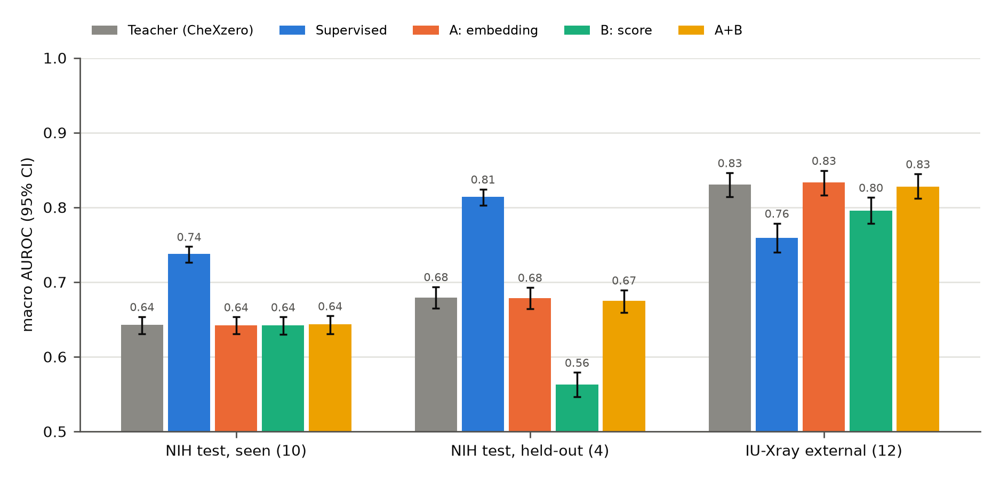

# What Survives Compression? Distilling a Medical Vision-Language Model into a Lightweight CNN

COMPSCI 682 final project, UMass Amherst, Fall 2026.
Chirag Aparadh, Gautham Mallipeddi, Mohak Subramanya Murthy.

Medical vision-language models can score a chest X-ray for any finding you can write as a text prompt, but their image encoders are large. We distill one (CheXzero) into a ResNet-18 using only unlabeled images, and test which of the teacher's abilities the small model keeps.

## Results

Macro AUROC (0.5 is chance), mean over 3 training seeds. Confidence intervals, per-finding tables and the command behind every number are in [RESULTS.md](RESULTS.md).

| model | NIH all 14 | NIH seen (10) | NIH held-out (4) | IU-Xray (12) |
|---|---:|---:|---:|---:|
| Teacher (CheXzero) | 0.653 | 0.643 | 0.679 | 0.831 |
| Supervised ResNet-18 | 0.760 | 0.737 | 0.818 (trained on these) | 0.765 |
| A: embedding matching | 0.652 | 0.641 | 0.679 | 0.831 |
| B: score matching | 0.617 | 0.642 | 0.557 | 0.796 |
| A+B | 0.652 | 0.642 | 0.675 | 0.828 |



- **Embedding matching keeps the teacher's performance** on NIH and on IU-Xray, with 11.4M image-encoder parameters instead of 87.8M, and 3.9x lower CPU latency.
- **Score matching keeps only the findings it trained on.** It falls to 0.557 on the held-out ones.
- **Adding score matching to embedding matching changes little**: at most 0.004.
- **The supervised model is better on NIH and worse on IU-Xray.** It uses the NIH labels; the distilled students never do.

Limits: one teacher checkpoint, one student architecture, and NIH labels mined from reports by text processing. The supervised baseline overfits after about 3 epochs and no checkpoint selection is used, so it is somewhat understated.

This is a research project. It is not for clinical use.

## Method

The teacher is CheXzero (a CLIP ViT-B/32 trained on MIMIC-CXR reports), kept frozen. The student is an ImageNet ResNet-18 whose last layer maps to CheXzero's 512-d embedding space. The student trains on NIH ChestX-ray14 images using only the teacher's outputs. At test time its embedding is scored against cached CheXzero text embeddings of a `"{finding}"` / `"no {finding}"` prompt pair, with a softmax over the pair, exactly like the teacher.

Arms. All of them share architecture, init, data, epochs, optimizer and schedule:

| arm | loss |
|---|---|
| `supervised` | BCE on the 14 NIH labels (14-d head, no text) |
| `A` | 1 - cosine(student embedding, teacher embedding) |
| `B` | per-finding KL to the teacher's prompt-pair scores, computed through the frozen text bank, seen findings only |
| `AB` | A + 1.0 * B |

Generalization tests were fixed before training:

- 4 held-out findings that B never trains on. A uses no findings at all, so nothing is held out from it (`HELD_OUT` in `src/medical_vlm_distillation/teacher.py`).
- 5 withheld prompt paraphrases (`TEMPLATES[1:]`).
- IU-Xray as the external set.

## Setup

Needs a CUDA GPU (developed on an 8 GB RTX 3080 Laptop) and [uv](https://docs.astral.sh/uv/).

```bash
uv sync
scripts/download.sh            # ~45 GB NIH zips + metadata + CheXzero checkpoints; rerun until ALL_DONE
```

## Pipeline

Run each step from the repo root. Times are on the machine above.

```bash
# 1. NIH: decode the 112,120 PNGs with CheXzero's preprocessing into data/nih_224.npy (uint8),
#    then write data/splits.csv: official test list = test, train_val split 90/10 by patient (seed 682).
#    Asserts zero patient overlap. ~100 s per zip; incremental, rerun until "12/12 zips processed".
uv run python scripts/prepare_nih.py

# 2. Check the stored images reproduce CheXzero's own float pipeline (cosine of teacher embeddings).
uv run python scripts/check_preprocessing.py

# 3. IU-Xray external set: frontal images, MeSH terms mapped to NIH findings. Download-bound.
uv run python scripts/prepare_iu.py

# 4. Teacher: embed every NIH image once, cache embeddings + text bank, print val AUROC per prompt. ~4 min.
uv run python scripts/cache_teacher.py

# 5. Overfit check (any arm): 256 training images, 30 epochs, loss should go to ~0.
uv run python -m medical_vlm_distillation.train A --epochs 30 --limit 256 --name overfit_A

# 6. Full runs: 4 arms x seeds 0-2, 5 epochs each (~6 min per run). Logs in runs/<arm>_s<seed>/train.log.
#    Long-schedule ablation (30 epochs, seed 0): EPOCHS=30 SEEDS=0 scripts/run_all.sh, then evaluate.py --tag _e30
nohup scripts/run_all.sh > runs/run_all.log 2>&1 &

# 7. Tables (NIH test with patient-level bootstrap CIs, held-out, paraphrases, IU-Xray, agreement) -> results/
uv run python scripts/evaluate.py --seed 0
uv run python scripts/efficiency.py                 # params, size, latency -> results/efficiency.csv
uv run python scripts/figures.py --seed 0           # poster charts -> results/figures/
uv run python scripts/qualitative.py --arm A        # t-SNE + Grad-CAM -> results/figures/
```

One run: `uv run python -m medical_vlm_distillation.train {supervised,A,B,AB} --epochs 5 --seed 0`.

## Layout

```
src/medical_vlm_distillation/
  data.py            NIH metadata, patient split, CheXzero preprocessing, image-store Dataset
  teacher.py         CheXzero loading, prompt templates, text bank, held-out findings, cache
  chexzero_model.py  CheXzero's model.py, vendored unmodified (MIT)
  student.py         ResNet-18 student and the A / B losses
  train.py           one training run (any arm)
  evaluate.py        AUROC, patient-level bootstrap
scripts/             data prep, teacher cache, run_all, evaluation, figures
```

## Choices that differ from the proposal

- **NIH originals instead of MedMNIST+.** MedMNIST's chestmnist uses its own split and has no patient IDs, so a patient-disjoint split is impossible. We decode the original PNGs with CheXzero's own preprocessing: long side to 320 with LANCZOS, zero-pad, normalize, bicubic to 224. The stored 224 uint8 images give teacher embeddings with cosine >= 0.9999 to the exact float pipeline.
- **IU-Xray from a Hugging Face mirror.** The Open-i download links return errors. Labels come from the MeSH terms; reports marked "No Indexing" are dropped, and only findings with at least 20 positives are reported.
- **B uses the teacher's logit scale.** Its KL compares softmaxes of `exp(logit_scale) * cosine`. AUROC does not change, because the scale is monotone. Without it, the temperature-1 targets all sit near 0.5 and carry almost no signal.
- **5 epochs for every arm.** 30 epochs made the supervised baseline memorize the training set (val AUROC 0.80 -> 0.70); see RESULTS.md section 5.
- **No augmentation and no model selection.** Teacher targets are cached on unaugmented images, and every arm keeps its last epoch, so labels never pick a checkpoint.
- **Checkpoint.** `best_64_5e-05_original_22000_0.864.pt`, one of the 10 released CheXzero checkpoints. We use this one alone, not the 10-model ensemble.

## Credits

- [CheXzero](https://github.com/rajpurkarlab/CheXzero) (Tiu et al., 2022): the teacher. `src/medical_vlm_distillation/chexzero_model.py` is vendored under its MIT license.
- [NIH ChestX-ray14](https://nihcc.app.box.com/v/ChestXray-NIHCC) (Wang et al., 2017): training and test images.
- IU-Xray / Open-i (Demner-Fushman et al., 2016): external test set.

Datasets and checkpoints are not in this repo; `scripts/download.sh` fetches them.
